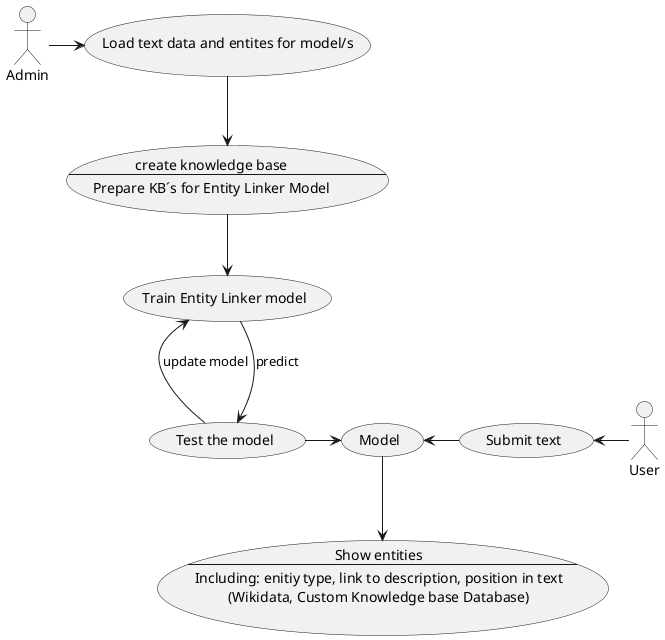

# Named Entity Service

Sören Räuchle, Nadav Babai | [3pc GmbH](https://www.3pc.de)

This service is analysing text for extracting Named Entities, Linked Entities, Abbreviations and Sentiment Scores for the german language.

[Service Documentation](https://www.overleaf.com/read/mdbgvfqpqvmg)

### Technology Stack
- [Python 3.7](https://www.python.org/)
- [FastAPI](https://fastapi.tiangolo.com/)
- [Conda](https://www.anaconda.com/)
- [Spacy](https://spacy.io/)
- [SciSpacy](https://github.com/allenai/scispacy)

### Frontend
The Frontend is injected inside the ```ner_service/templates folder```.

### Named Entities
The Named Entities are a hybrid of AI and Gazetter Dictionaty matching. 
The AI is looking for the Grammar and is using a Spacy Model. The Gazetter Matching is based on Entities extracted from the 3pc.de Website.

### Abbreviation Detection
The Abbreviation Detection is based a Algorithm described in a Paper of A.S. Schwartz and M.A. Hearst. 
Additionally the Detection is extracting Abbreviations from HTML Content.

### Sentiment Analysis
Sentiment Analysis is done with a Sentiment Dictionary for the german language in combination with a lemmatizer.

### PyCharm IDE and Conda Setup
To see fully gets the logs make sure to: 
##### Run > Edit Configuration >  Emulate terminal in output console
Install the environment with: 
```
conda env create -f environment.yml
```
Update the environment with: 
```
conda env update -f environment.yml
```

### Papers
- [A Simple Algorithm for Identifying Abbreviation Definitions in Biomedical Text](https://psb.stanford.edu/psb-online/proceedings/psb03/schwartz.pdf)


### Use case diagram , Named Entity Recognition.


